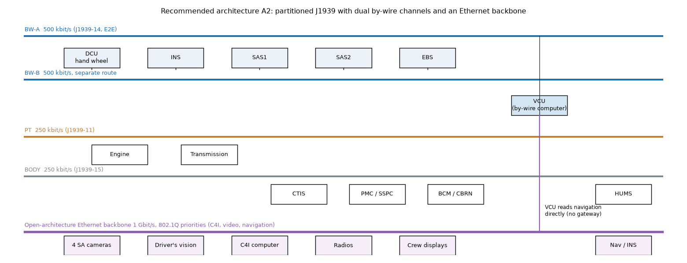
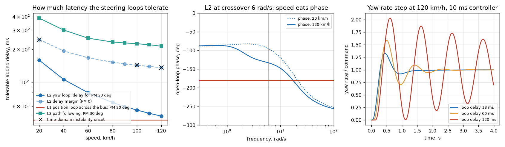
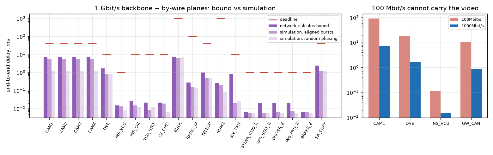
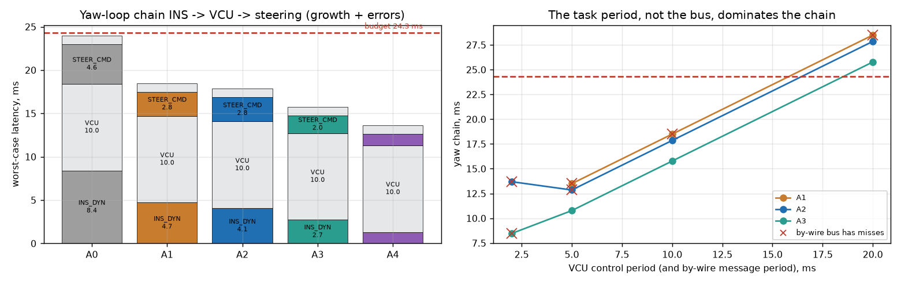
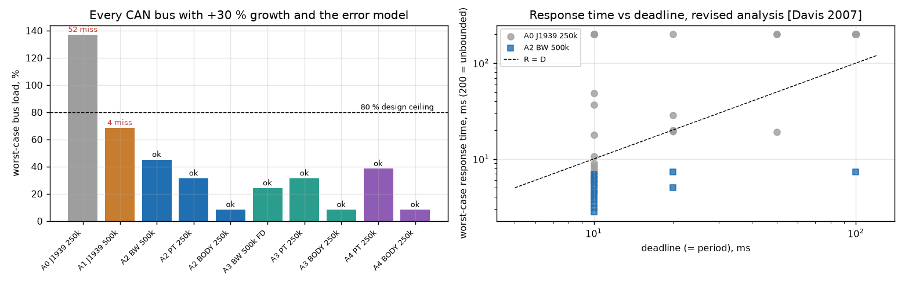
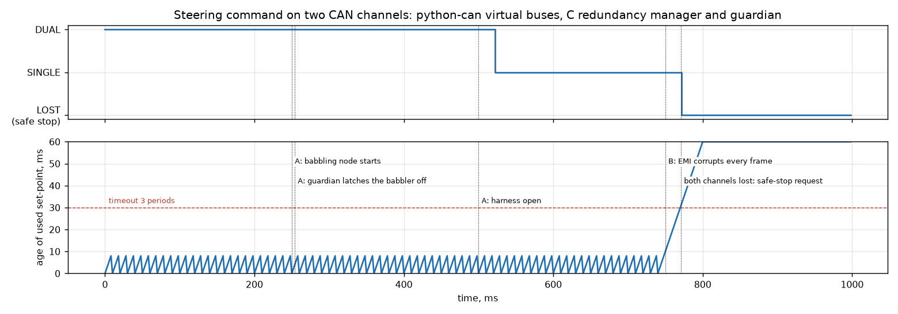
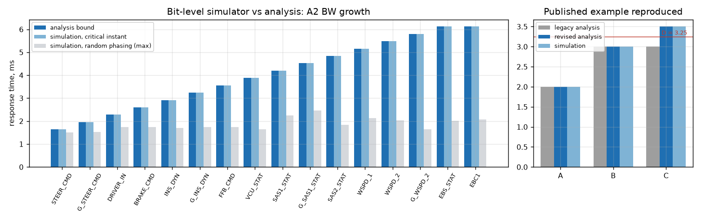
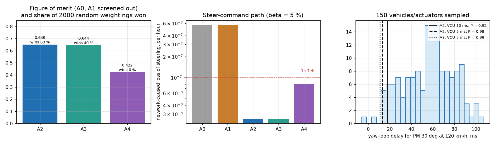

# Engineering dossier: in-vehicle network architecture of a drive-by-wire wheeled armoured vehicle

Rev A, 10 Nov 2026. Author: Chander Vinayak Sharma. Student engineering study; no programme, customer or product data were used beyond the public sources in section 18.

**How to read the numbers.** Every engineering value carries one of three tags, in the data files (`data/*.yaml`) and here:
**[S]** sourced: read in the cited document (section 18 key in brackets);
**[D]** derived: computed from sourced values or from the models here, with the derivation given;
**[A]** assumed: an engineering assumption, listed again in section 16 and, where it matters, swept in a sensitivity run.
Wasson (2016) is cited as [W ch.x, p.N] with the printed page number. Result tables R1-R12 are in [docs/RESULTS.md](docs/RESULTS.md), regenerated by `python -m vnet all` and `python tools/results_md.py`.

---

## 0. The question and the answer

**Central question.** A wheeled armoured vehicle of the 8x8 class is being given a drive-by-wire digital platform: steer-, brake- and throttle-by-wire under a vehicle control unit (VCU), alongside the usual J1939 powertrain and chassis electronics (engine, transmission, brakes, tyre inflation, power management, body), a C4I suite, situational-awareness (SA) video and an open-architecture Ethernet backbone. **Which in-vehicle network architecture meets the hard end-to-end latency deadlines of the safety-critical control loops, keeps every bus within its load margin with growth, and survives any single network fault? And what latency can the steer-by-wire loop actually tolerate?**

The second half of the question decides the first: a network can only be judged against a deadline, and the deadline of a by-wire loop is a property of the vehicle's dynamics, not of the network.

**Answer** (numbers from `results/`, tables in [docs/RESULTS.md](docs/RESULTS.md)):

1. **What the steering loops tolerate (R5, section 8.2).** A linear multi-axle single-track model of a 25 t 8x8 (two steered axles, understeer gradient 2.71 deg/g [D]) with a 3 Hz road-wheel actuator [A] gives:
   - **L2, yaw-rate stabilisation** (crossover held at 6 rad/s): the delay that still leaves 30 deg of phase margin falls from **158.9 ms at 20 km/h to 48.6 ms at 120 km/h**, because the vehicle's yaw mode loses damping with speed (damping ratio 0.99 to 0.69). The time-domain model confirms the delay margin within 0.4 % (136 ms analytical vs 135.9 ms simulated at 120 km/h).
   - **L1, the actuator position loop, if it were closed by the VCU across the network:** 44.8 ms for PM 30 deg, independent of speed.
   - **L3, pure-pursuit path following** (remote or semi-autonomous driving): 213 ms at 120 km/h.
   - Holding half of that as margin [W ch.31, Principle 31.1, p. 667] sets the network-chain budget: **the yaw chain INS -> VCU -> steering actuator must stay within 24.3 ms** at 120 km/h. This is the key performance parameter.
2. **The legacy single 250 kbit/s J1939 bus cannot host by-wire (R3).** Adding the by-wire set at 100 Hz takes the worst-case bus load to **99.0 % before any growth; 8 messages miss their deadlines** (137.1 % and 52 misses with +30 % growth and the error model). Every by-wire message on that bus also shares one copper pair with every other node, so one short, open circuit or babbling node removes steering.
3. **A single 500 kbit/s bus (J1939-14) fits the load but fails two other requirements.** With growth and the error model it runs at 68.5 % and meets the yaw budget (18.5 ms), but the navigation frames gatewayed from the backbone inherit 17 ms of jitter and miss (R3: 25.4 ms against 10 ms), and a single network fault still removes steering. Even one babbling frame per 100 ms at top priority breaks a deadline on it (R8).
4. **Recommended: A2, a partitioned network** (section 6.2): **two independent 500 kbit/s by-wire channels on separate routes** carrying the by-wire set with E2E protection, a 250 kbit/s powertrain bus, a 250 kbit/s chassis/body bus and a **1 Gbit/s open-architecture Ethernet backbone** that the VCU reads directly.
   - With +30 % growth and a harsh error model, every frame on every bus meets its deadline; the by-wire channels run at **45.1 %** (R3).
   - **Yaw chain 17.9 ms against the 24.3 ms budget**; of that, only **6.9 ms is the bus**; 11 ms is the VCU and actuator task periods (R6).
   - Any single network fault leaves steering on the other channel; the C redundancy manager keeps the set-point age at one period (9 ms) and, when both channels die, requests a safe stop **21 ms** after the first missing frame (R8, inside the 30 ms timeout of SR-32).
   - Network-caused loss of the steering command: **2.6e-8 per hour**, set by the 5 % common-cause beta, not by the hardware rates; a single bus gives 5.7e-7 per hour (R9).
5. **The deciding parameter is the VCU task period, and the growth path is CAN FD.** Halving the VCU period to 5 ms cuts the yaw chain by 5 ms, more than every bus upgrade together; but with 5 ms frames the classical 500 kbit/s channels reach **74 % load and 3 misses** with growth, while CAN FD (J1939-22, 500 kbit/s / 2 Mbit/s, A3) holds them at **40 % with none** and gives a 10.8 ms chain (R6). Over 150 sampled vehicles and actuators the 10 ms A2 chain stays within the 30 deg delay in 95 % of cases and the 5 ms CAN FD chain in 99 % (R12).
6. **Trade study (R10).** A0 and A1 are screened out. A2 (FOM 0.649) and A3 (0.644) are a near tie; A2 wins 60 % of 2000 random weightings, A3 40 %, the all-Ethernet A4 (0.422) none. The recommendation is **A2 now, with CAN FD-capable transceivers and the same harness, so that A3 is a configuration change** when the by-wire loop rate rises (decision D06).
7. **The analysis itself is checked (section 13).** The response-time tool reproduces the published CAN example and breakdown table of Davis et al. (2007) exactly (R1); a bit-level CAN simulator equals the analysis in every critical-instant scenario and stays below it under random phasing (R4); the Ethernet simulator stays below the network-calculus bounds and reaches 80 % of them for aligned video bursts (R7).

**Still open** (section 15): hardware-in-the-loop timing on real controllers and transceivers, the real actuator bandwidth (it moves the budget most, R12), and EMC tests of the dual-channel harness.

---

## 1. Scope, system of interest and method

**System of interest (SOI).** The vehicle data networks from the network interface of each electronic control unit (ECU) to the interface of every other: CAN buses (J1939) with their harnesses, terminations and transceivers, the Ethernet backbone with its switches, the gateway functions, and the communication software that makes the networks dependable (end-to-end protection, redundancy management, bus guardian). The ECUs' application functions (steering control, engine control) and the vehicle are external systems; the vehicle's lateral dynamics enter only to set the deadlines. The networks are an *enabling system* for the by-wire *mission system* [W ch.4, p. 76-84].

**Method.** Wasson's sequence: user needs and mission analysis (ch. 4-5), ConOps (ch. 6), phases, modes and states (ch. 7), requirements derived from standards (ch. 19-22), architecture and interfaces (ch. 26-27), budgets and margins (ch. 31), the trade study (ch. 32), modelling and simulation (ch. 33), reliability (ch. 34), verification and validation (ch. 13, 28). Wasson's own pointer for real-time and frame-based systems is rate-monotonic style schedulability analysis [W ch.31, Author's Note 31.4, p. 679]; for CAN this is the response-time analysis of Davis et al. [DAVIS2007], used here throughout.

**What was built** (all in this repository):
- `vnet/canframe.py`: CAN frames bit by bit (CRC-15, bit stuffing), the worst-case length bound, CAN FD lengths.
- `vnet/rta.py`: the revised CAN response-time analysis with an error model, the flawed legacy analysis (kept to show the flaw), and the sufficient test [DAVIS2007 Eq. 1-20].
- `vnet/cansim.py`: a discrete-event CAN bus simulator (arbitration, exact stuffing, error frames).
- `vnet/j1939.py`, `network.py`: J1939 identifiers and the per-architecture message sets.
- `vnet/ethernet.py`: network-calculus delay bounds for strict-priority switched Ethernet and a packet-level simulator.
- `vnet/dynamics.py`: the multi-axle lateral model, the three steering loops, their margins and a time-domain check.
- `vnet/latency.py`: end-to-end cause-effect chains.
- `c/e2e_guard.c`: E2E protection, the dual-channel redundancy manager and a transmit bus guardian in C99, unit-tested in C and called from Python through `ctypes`, exercised on python-can virtual buses.
- `vnet/rma.py`, `aoa.py`, `studies.py`, the DBC of the message set (`docs/vehicle.dbc`), tests and CI.

---

## 2. User needs and problem statement (Wasson ch. 4-5)

### 2.1 Stakeholders [W ch.4, p. 76-84]

| Role | Who | Main concern |
|---|---|---|
| User | Driver and commander | The vehicle steers and brakes exactly as commanded, at every speed, after any single failure |
| End users | Remote operator / autonomy kit (optional) | Path-following works over the same platform |
| Maintainer | Field and depot maintenance | Faults are located from the crew station or one standard tool; harness sections are swappable |
| Acquirer / integrator | The vehicle integrator | Mass, cost, integration risk; open interfaces as the national open-architecture standard asks [COS599905 section 7] |
| Equipment suppliers | ECU, actuator and C4I suppliers | A stable, documented interface control document (ICD) |
| System threat | EMI from own radios and jammers, blast and fragment damage to harnesses | Defeats the network if one cut or one burst can take it down |

### 2.2 Problem statement [W ch.4, Principle 4.15, p. 91]

> When steering, braking and throttle become by-wire functions on a vehicle whose electronics share one 250 kbit/s J1939 bus, no worst-case latency can be guaranteed for the control loops, the bus has no room for growth, and a single network fault removes steering.

*Discussion.* The national adoption of the NATO generic vehicle architecture asks for data-controlled powertrain and braking as a minimum and prefers two bus types, CAN and Ethernet, for combat vehicles; it also requires that growth in data traffic shall not affect safety-critical properties [COS599905 section 7 and 7.1, p. 16-18] **[S]**. The problem is real, not perceived [W ch.4]: R3 shows a 250 kbit/s bus at 99 % load before growth.

*Five whys.* Why can a by-wire command arrive too late?
1. It waits behind other frames on the bus.
2. Why so long? The bus is nearly full and non-pre-emptive: a lower-priority frame in transmission blocks it, and higher-priority frames keep winning arbitration.
3. Why is it full? By-wire loops need 100 Hz frames, each 0.64 ms long at 250 kbit/s with worst-case stuffing [D, Eq. 1 of DAVIS2007].
4. Why does that matter more than on the legacy vehicle? The legacy traffic was mostly 100-1000 ms status data [FMS2010]; by-wire adds a dozen 10 ms frames.
5. Why is it also a safety problem? One copper pair carries all of it, so its failure modes (short, open, babbling node) are common to every function.

---

## 3. Mission analysis and concept of operations (Wasson ch. 5-6)

### 3.1 Mission statement and objectives [W ch.5, Principle 5.2, p. 108]

**Mission:** carry every control and information flow of the vehicle with a guaranteed worst-case latency, and keep the by-wire functions working after any single network fault.

| Objective type | Objective |
|---|---|
| Primary | By-wire command chains within their latency budgets (section 5.1) at every speed up to 120 km/h |
| Primary | No single network fault removes steering, braking or throttle |
| Secondary | C4I, video and navigation on an open-architecture Ethernet backbone with bounded delay |
| Secondary | 30 % message growth over life without redesign |
| Supporting | Health and usage monitoring and diagnostics from one standard tool |

### 3.2 Operating environment

- **Electrical:** 28 V vehicle power per MIL-STD-1275F (starting dips to 12 V for up to 1 s, a 100 V surge) [MIL1275F] **[S]**; network nodes must keep communicating through them.
- **Electromagnetic:** own VHF/HF radios keyed next to the harness, jammers; conducted and radiated susceptibility per MIL-STD-461G CS114/RS103 [MIL461G]. Modelled as a burst of 2 errors plus one error every 10 ms on every bus **[A]**, far above the 1e-11 to 1e-6 bit-error rates reported for CAN [DAVIS2007 p. 261] **[S]**: a deliberately harsh case.
- **Physical:** harness routes through the hull, exposed to chafe, crush, fragment and fire damage; the reference backbone route is 22 m **[A]**.

### 3.3 Mission event timeline (MET) [W ch.5, p. 107-114]

| Phase | Network activity | Timing driver |
|---|---|---|
| Power-up | ECUs boot, J1939 address claim (250 ms contest window [J1939TP]), E2E counters synchronise | Driving is inhibited until the redundancy manager reports DUAL |
| Road march, up to 120 km/h | By-wire loops at 100 Hz, powertrain at 10-100 ms, SA video, C4I | Yaw loop L2 at top speed (section 8.2) |
| Cross-country, 20-60 km/h | Same, high steering activity, CTIS changes | Driver steering chain, brake chain |
| Remote / semi-autonomous drive | Path following from navigation over the backbone | Path loop L3, teleoperation video |
| Halt, silent watch | By-wire idle, C4I and HUMS active | Backbone capacity |
| Maintenance | Diagnostic sessions, transport-protocol transfers | Must not break deadlines (Davis section 4.4 warns that diagnostic frames are often forgotten in analyses [DAVIS2007 p. 262]) |

### 3.4 Use cases [W ch.5, p. 117-127]

| UC | Actor | Trigger | Main success scenario | Exception |
|---|---|---|---|---|
| UC1 Steer at speed | Driver | Hand-wheel input at 100 km/h | DRIVER_IN -> VCU -> STEER_CMD -> actuators within 50 ms; yaw loop stable | Channel lost -> UC4 |
| UC2 Stabilise yaw | VCU | Yaw-rate error from the inertial unit | Correction applied within the L2 budget | Budget exceeded -> loop degrades (R5) |
| UC3 Follow a path | Autonomy kit | Route from the C4I system | Path loop from backbone navigation | Backbone lost -> driver control |
| UC4 Survive a network fault | Redundancy manager | Open, short, babbling node, bus-off | Freshest valid copy from the other channel, crew warned | Both lost -> safe stop (UC5) |
| UC5 Safe stop | VCU | Both by-wire channels lost for 30 ms | Hold steering, controlled braking through the brake system's fallback | - |
| UC6 Grow the vehicle | Integrator | New function (rear-axle steer, active suspension) | Added frames fit without reallocation (30 % growth) | Move to CAN FD (D06) |
| UC7 Diagnose | Maintainer | Fault on the crew display | HUMS and DM1 data locate the node and the channel | - |

### 3.5 ConOps summary [W ch.6, p. 129-145]

The vehicle runs four networks in the recommended architecture. The two by-wire channels carry the same frames, sent by every by-wire node on both, each protected end to end; receivers take the freshest valid copy. The powertrain bus keeps the legacy J1939 engine and transmission untouched. The body bus carries tyre inflation, power management, lights, hatches, CBRN and diagnostics. The Ethernet backbone carries C4I, video and navigation with IEEE 802.1Q priorities; the VCU has its own port, so loop data never passes a gateway.

---

## 4. Phases, modes and states (Wasson ch. 7)

### 4.1 Phases of operation [W ch.7, p. 150]

Pre-mission (power-up, built-in test), mission (drive, halt), post-mission (shutdown, download of HUMS data).

### 4.2 Network modes [W ch.7, p. 157-168]

| Mode | Entry | Exit | By-wire service |
|---|---|---|---|
| INIT | Power-up | Both channels deliver valid E2E frames | Driving inhibited |
| NORMAL (DUAL) | Both channels fresh (valid frame within 30 ms) | One channel times out | Full; cross-channel comparison active |
| DEGRADED (SINGLE_A / SINGLE_B) | One channel stale for 30 ms | Channel recovers, or the other is lost | Full performance, no redundancy; crew warning; speed limit is a vehicle-level decision |
| LOST | Both channels stale for 30 ms | Power cycle after repair | None: safe stop requested |
| MAINTENANCE | Diagnostic tool connected, vehicle stationary | Tool removed | Transport-protocol transfers allowed at J1939 priority 7 |

### 4.3 States inside a channel (CAN fault confinement) [CAN20 p. 24-26]

ERROR ACTIVE (TEC and REC <= 127) -> ERROR PASSIVE (>= 128) -> BUS OFF (TEC >= 256) -> recovery after 128 occurrences of 11 recessive bits **[S]**. A node that fails every transmission reaches bus-off after 32 frames: **12.2 ms at 500 kbit/s, 24.4 ms at 250 kbit/s**; recovery takes at least 2.82 ms at 500 kbit/s, plus the 100 ms application delay assumed here **[A]** (R8).

### 4.4 Allowable / prohibited actions [W ch.7, Principle 7.10, p. 169]

| Action \ mode | INIT | DUAL | SINGLE | LOST | MAINT |
|---|---|---|---|---|---|
| Drive under by-wire | no | yes | yes, warned | no (safe stop) | no |
| Path following (autonomy) | no | yes | no (decision D09) | no | no |
| Diagnostic TP transfers | yes | yes, priority 7 | no | yes | yes |
| Re-flash an ECU | no | no | no | no | yes |
| Re-enable a guardian-latched node | no | no | no | no | yes (by tool) |

---

## 5. Requirements (Wasson ch. 19-22)

### 5.1 Derivation of the key performance parameter

**KPP-1 by-wire latency.** The worst-case data age of the yaw-stabilisation chain (inertial unit -> VCU -> steering actuators) shall not exceed half of the added delay that leaves the yaw loop 30 deg of phase margin at the top speed of 120 km/h.

- **Why phase margin 30 deg:** the classical lower bound of a robust loop; 30-60 deg is the usual design range [OGATA2010] **[A]**.
- **Why half:** the other half is the design margin held against the model and parameter uncertainty [W ch.31, Principle 31.1, p. 667: budgets carry a margin of safety] **[A]**; R12 shows the uncertainty is real.
- **Value:** 0.5 x 48.6 ms = **24.3 ms [D]** (R5, section 8.2).
- **Why the yaw loop:** with the position loop inside the actuator (decision D02) it has the smallest tolerance of the loops that cross the network. If the position loop were closed by the VCU (L1), its budget would be 0.5 x 44.8 = 22.4 ms.

The other budgets follow the same way (apportionment of a timing MOP [W ch.31, Principle 31.4, p. 668]): path chain 0.5 x 213 = 107 ms **[D]**; driver steering and brake chains 50 ms **[A]**.

### 5.2 Requirements table (one MOP per requirement, Principle 20.1, p. 418; statement form, Principle 22.5, p. 449)

Verification methods: I inspection, A analysis, D demonstration, T test [W ch.22, section 22.5, p. 453]. "Model" means the analysis or test runs on the models here; the hardware method is in section 14. Condition types follow Principle 19.22 [W p. 411].

| ID | Requirement | Source / derivation | Condition | Verification |
|---|---|---|---|---|
| SR-01 | The yaw-stabilisation chain (inertial unit -> VCU -> steering actuators) shall have a worst-case data age <= 24.3 ms with +30 % message growth and the error model of 3.2. | KPP-1; R5 | Normal + Abnormal (external) | A + T (model IT02); HIL T |
| SR-02 | The steering road-wheel position loop shall be closed inside the actuator; the network shall carry set-points and status only. | L1 analysis (8.2): a VCU-closed loop needs <= 22.4 ms, which the legacy bus misses (52.5 ms) and a single 500k bus barely meets (21.1 ms) | Normal | A (model IT03) |
| SR-03 | The path-following chain (navigation -> VCU -> actuators) shall have a worst-case data age <= 107 ms. | R5 L3 at 120 km/h | Normal | A + T (model IT02) |
| SR-04 | The driver steering and brake chains (hand wheel or pedal -> VCU -> actuator) shall have a worst-case data age <= 50 ms. | [A] perceptible-lag allowance | Normal | A + T (model IT02) |
| SR-10 | Every periodic CAN message shall meet a deadline equal to its period in the worst case, with +30 % growth and the error model (2-error burst + 1 error / 10 ms). | [DAVIS2007] section 3, Eq. 19-20; growth [A] | Normal + Abnormal (external) | A (model IT01, UT) |
| SR-11 | The worst-case load of every CAN bus, with +30 % growth, shall not exceed 80 %. | [DAVIS2007 p. 243]: about 80 % is what analysis-based design reaches | Normal | A (model IT01) |
| SR-12 | Schedulability shall be shown with the revised analysis of [DAVIS2007] section 3 (all instances in the busy period), not the original single-instance analysis. | [DAVIS2007] sections 1.4, 3.1-3.2: the original analysis is optimistic | - | A (UT) |
| SR-13 | Every CAN bus shall stay within its J1939 physical-layer limits (backbone 40 m at 250 kbit/s, 30 m at 500 kbit/s; stubs 1 m (3 m for -15); <= 30 nodes) and inside the arbitration round-trip limit. | [J1939PHY], [CAN20], [ISO11898] | Normal | A + I (model IT09) |
| SR-14 | Data that closes a vehicle-control loop shall reach the VCU without passing a gateway. | Gatewayed frames inherit jitter [DAVIS2007 section 4.2]; R3 NAV_POS misses on A1 | Normal | A (model IT03) |
| SR-20 | The backbone shall carry C4I, SA video, driver's vision and navigation with IEEE 802.1Q priorities; worst-case delays: navigation and control <= 1 ms, driver's vision <= 10 ms, SA video <= 40 ms. | [COS599905] 7.1 (growth must not affect safety-critical traffic); [IEEE8021Q]; delays [A] | Normal | A + T (model IT07, UT) |
| SR-21 | The vehicle shall use two network types, CAN for vehicle control and Ethernet for the data infrastructure. | [COS599905 p. 18] "optimal architecture of combat vehicles" | - | I (model IT07) |
| SR-30 | No single network fault (open, short, short to 28 V, babbling node, bus-off, loss of termination) shall remove steering, braking or throttle. | Severity 1 hazards [MIL882E]; [ISO26262] fault-tolerance concept | Abnormal (internal) | A + T (model IT04, IT10) |
| SR-31 | The network contribution to loss of the steering command shall be <= 1e-7 per hour. | [IEC61508-6] SIL 3 continuous-mode band (secondary) | Abnormal (internal) | A (RBD, model IT10) |
| SR-32 | Loss of both by-wire channels shall be detected and a safe stop requested within 30 ms (3 message periods) of the first missing or corrupted frame. | Fault tolerant time interval concept [ISO26262]; 3 periods [A] | Emergency | T (model IT04, C UT) |
| SR-50 | Every by-wire node shall send each by-wire frame on both channels; receivers shall use the freshest valid copy, so that the set-point age stays within one period while one channel is healthy. | SR-30 | Abnormal (internal) | T (C UT, model IT04) |
| SR-51 | The redundancy manager shall report each channel as lost after 30 ms without a valid frame and shall report the network mode (section 4.2). | SR-32 | Abnormal (internal) | T (C UT, model IT04) |
| SR-52 | Every by-wire frame shall carry an E2E header (CRC-8 SAE J1850 over a 16-bit data ID and the payload, 4-bit counter 0-14) that detects corruption, repetition, loss, wrong sequence and masquerade; copies of equal counter that differ shall be flagged. | [AUTOSAR-E2E] Profile 1, Tables 6.12-6.13 | Abnormal (internal + external) | T (C UT, UT, model IT06) |
| SR-53 | Every by-wire node shall have a transmit guardian that limits it to its configured frame rate and latches its transmitter off after 20 consecutive violations; the configured rate shall be below the rate that breaks any deadline. | Babbling idiot (FM05); threshold from R8 | Abnormal (internal) | T (C UT, model IT04, IT05) |
| SR-54 | A node in bus-off shall rejoin only after the recovery sequence of [CAN20] rule 12 plus 100 ms, and the by-wire status it sends shall stay available on the other channel meanwhile. | [CAN20] p. 26; app delay [A] | Abnormal (internal) | A + T (UT) |
| MS-01 | The response-time tool shall reproduce the published example and breakdown table of [DAVIS2007] and the CRC check values of [CRCCAT]. | [W ch.33] model credibility | - | T (UT) |
| MS-02 | The CAN simulator shall equal the analysis in each message's critical-instant scenario and stay below it under random phasing; the Ethernet simulator shall stay below the network-calculus bounds. | [W ch.33]; [LEBOUDEC2001] | - | T (UT) |
| MS-03 | Every non-assumed number in the data set shall resolve to a reference. | [W ch.19]; Principle 32.10 | - | I (UT, CI) |
| MS-04 | The frequency-domain delay margin of the steering loops shall agree with the time-domain onset of instability within 4 %. | [W ch.33] | - | T (UT) |

Every requirement traces to at least one test in [docs/traceability.md](docs/traceability.md), generated from the test markers and checked in CI.

---

## 6. Architecture (Wasson ch. 26)

### 6.1 Candidate architectures [W ch.26, Principle 26.10, p. 553: record the candidates and the rationale]

| ID | By-wire transport | Powertrain / body | Backbone | Note |
|---|---|---|---|---|
| A0 | Shared 250 kbit/s J1939 bus (J1939-11) | same bus | 100 Mbit/s, C4I only, navigation through a gateway | legacy bus with by-wire added |
| A1 | Shared 500 kbit/s J1939 bus (J1939-14) | same bus | 100 Mbit/s, gateway | the minimum upgrade |
| A2 | **Two independent 500 kbit/s channels**, E2E, separate routes | 250k powertrain + 250k body | 1 Gbit/s, VCU on the backbone | partitioned |
| A3 | Two CAN FD channels (J1939-22, 500 kbit/s / 2 Mbit/s) | 250k + 250k | 1 Gbit/s | partitioned, FD |
| A4 | Two redundant Ethernet planes with time-sensitive networking | 250k + 250k for legacy ECUs | 1 Gbit/s | by-wire on Ethernet |

The domain split follows the functional allocation [W ch.26, p. 554-559]: control loops, powertrain (legacy J1939 ECUs that are bought, not designed), chassis/body (slow), and data (Ethernet). The candidates are defined in `data/architectures.yaml`.

### 6.2 Selected architecture: A2 (from the trade study, section 11)

- **By-wire channels BW-A and BW-B**, 500 kbit/s, J1939 29-bit identifiers [J1939TP], the same frames on both: hand-wheel unit (DCU), inertial unit (INS), two steering actuators (SAS1, SAS2), brake controller (EBS), VCU. Channel B runs on the opposite side of the hull (decision D05: the common-cause beta dominates the failure rate, R9).
- **Powertrain bus PT**, 250 kbit/s: engine and transmission keep their standard J1939 parameter groups (EEC1 20 ms, EEC2 50 ms, CCVS 100 ms [FMS2010] **[S]**); the VCU sends the torque request (TSC1) here.
- **Body bus BODY**, 250 kbit/s: tyre inflation, power-management controller (the SSPC panel of the author's power-system study), lights, hatches, CBRN, HUMS and the diagnostic traffic.
- **Backbone**, 1 Gbit/s switched Ethernet, IEEE 802.1Q priority code points (PCP): navigation and control 6, driver's vision 5, SA video and teleoperation 4, radio IP 3, HUMS 1, bulk C4I 0. The VCU has a port of its own (SR-14).
- **Software in every by-wire node:** `c/e2e_guard.c` (E2E protect/check, redundancy manager, transmit guardian).
- **Position loops** inside the actuators (SR-02).

---

## 7. Interfaces (Wasson ch. 27)

### 7.1 Interface register [W ch.27, Principle 27.3, p. 577: every interface has an owner]

| IF | Between | Medium / standard | Owner | Key characteristics |
|---|---|---|---|---|
| IF-01 | By-wire nodes <-> BW-A, BW-B | CAN 2.0B / J1939-14, 500 kbit/s, shielded twisted pair | Vehicle integrator | 29-bit IDs, E2E header, 10-20 ms periods, guardian |
| IF-02 | Engine, transmission <-> PT | J1939-11, 250 kbit/s | Integrator (ECUs bought in) | Standard parameter groups, no change to the ECUs |
| IF-03 | Body nodes <-> BODY | J1939-15, 250 kbit/s, unshielded | Integrator | Status 100-1000 ms, DM1, transport protocol |
| IF-04 | VCU, INS, C4I, cameras, displays <-> backbone | 1000BASE-T, IEEE 802.1Q | Integrator / C4I supplier | PCP map, bounded delay (8.5) |
| IF-05 | `e2e_guard` <-> application | C API (`c/e2e_guard.h`) | VCU and actuator software | protect/check, rm_on_frame/rm_tick, guard_allow |
| IF-06 | Any node <-> 28 V supply | MIL-STD-1275F | Integrator | Nodes keep communicating through starting dips [MIL1275F] |
| IF-07 | Maintenance tool <-> BODY / backbone | J1939-73 DM1, request PGN, transport protocol | Integrator | Priority 7 transfers, maintenance mode only for re-flash |

### 7.2 ICD: by-wire message set (IF-01; full set in `data/messages.yaml` and `docs/vehicle.dbc`)

| Message | PGN | J1939 prio | From | Bytes | Period | E2E | Content |
|---|---|---|---|---|---|---|---|
| STEER_CMD | 0xEF00 (PropA, global) | 1 | VCU | 8 | 10 ms | yes | Road-wheel set-points axle 1 and 2 (0.01 deg), rate limit, mode |
| DRIVER_IN | 0xFF02 | 1 | DCU | 8 | 10 ms | yes | Hand-wheel angle and rate, pedals |
| BRAKE_CMD | 0x0400 (XBR layout) | 2 | VCU | 8 | 10 ms | yes | Deceleration demand |
| TSC1_ENG | 0x0000 | 2 | VCU | 8 | 10 ms | yes | Torque request (on PT in A2) |
| INS_DYN | 0xF009 (VDC2 layout) | 2 | INS | 8 | 10 ms | yes | Yaw rate, lateral and longitudinal acceleration |
| SAS1/2_STAT | 0xFF10/11 | 3 | SAS1/2 | 8 | 10 ms | yes | Actual angle, rack force, faults |
| WSPD_1/2 | 0xFF20/21 | 3 | EBS | 8 | 10 ms | no | Eight wheel speeds |
| FFB_CMD | 0xEF00 (PropA to DCU) | 3 | VCU | 8 | 10 ms | yes | Hand-wheel feedback torque |
| EBS_STAT | 0xFF22 | 3 | EBS | 8 | 20 ms | yes | Brake pressures, ABS state |
| VCU_STAT | 0xFF01 | 3 | VCU | 8 | 20 ms | yes | Mode, degraded flags, heartbeat |

Periods and layouts of the by-wire groups are design choices **[A]**; standard groups keep their published rates [FMS2010] **[S]**. Source addresses are an assumed allocation.

**E2E header** (IF-05): byte 0 CRC-8 (polynomial 0x1D, start and final XOR 0x00) over data-ID low byte, data-ID high byte and bytes 1-7; byte 1 low nibble counter 0-14 [AUTOSAR-E2E Table 6.12] **[S]**. The data ID is not sent, so a frame under the wrong identifier fails the CRC. The CRC routine reproduces the catalogue check value 0x37 of CRC-8/GSM-A (same parameters) [CRCCAT].

### 7.3 Interface findings

- **IIR-01 Gatewayed loop data.** Navigation gatewayed from a 100 Mbit/s backbone onto CAN inherits the backbone's worst-case delay (10.2 ms with video on the same link) plus the gateway task period; on A1 the NAV_POS frame then misses (25.4 ms against 10 ms, R3). Resolved by SR-14 (VCU on the backbone).
- **IIR-02 Diagnostic traffic.** Two simultaneous BAM transfers at 50 ms packet spacing are included in every analysis; on A1 with growth they are among the frames that miss. The legacy practice of leaving them out of the analysis [DAVIS2007 section 4.4] is not followed.
- **IIR-03 Physical layer at 500 kbit/s.** The 30 m backbone limit quoted for J1939-14 comes from a secondary source only [J1939PHY]; the 22 m route is inside it, and the arbitration round-trip limit at 500 kbit/s is 118 m (R11), so the binding limit is the stub and ringing behaviour, which needs a harness test (section 14).

---

## 8. Performance budgets, margins and the physics behind them (Wasson ch. 31)

### 8.1 How long a CAN frame takes

A J1939 frame is a CAN 2.0B extended data frame: SOF, 11-bit base identifier, SRR, IDE, 18-bit extension, RTR, two reserved bits, 4-bit DLC, 0-8 data bytes, CRC-15, then CRC delimiter, ACK slot, ACK delimiter, 7-bit EOF and the 3-bit intermission [CAN20 p. 12-15] **[S]**. Bit stuffing inserts a complement bit after 5 equal bits from SOF to the end of the CRC; stuff bits count in the next run. The worst-case length is

C = (g + 8s + 13 + floor((g + 8s - 1)/4)) bit times, g = 54 (extended) [DAVIS2007 Eq. 1] **[S]**

so an 8-byte J1939 frame takes **160 bit times: 640 us at 250 kbit/s, 320 us at 500 kbit/s [D]**. `vnet/canframe.py` builds frames bit by bit; over 2500 random 8-byte extended frames the longest was 143 bits and the mean 135 (R2), so the bound is 12 % above anything random data produced: the margin the analysis keeps for adversarial payloads.

### 8.2 What latency the steering loops tolerate (the deciding physics)

**Vehicle model.** Linear single-track model with n axles: axle i at x_i from the centre of gravity, cornering stiffness C_i, steer gain k_i [WONG2008 ch. 5; RAJAMANI2012 ch. 2; CHALMERS2013 section 2]:

m (v' + u r) = sum C_i (k_i delta - (v + x_i r)/u),   I_z r' = sum x_i C_i (k_i delta - (v + x_i r)/u).

| Parameter | Value | Tag |
|---|---|---|
| Mass | 25 t (swept 20-33 t) | [A] 8x8 class |
| Axle positions from front | 0 / 1.45 / 3.50 / 4.95 m, loads 26/26/24/24 % | [A] |
| Yaw radius of gyration | 2.1 m (I_z = 110 t m^2) | [A] |
| Cornering stiffness per axle | 5.9 x axle load per rad | [D] from the 4.07e5 N/rad front axle of a heavy tractor on its 69.2 kN static load [CHALMERS2013 Table B.1] |
| Steering compliance on steered axles | x 0.8 | [A] |
| Second steered axle | 0.657 x the first (Ackermann about the rear bogie centre) | [D] |
| Road-wheel actuator (closed position loop) | 3 Hz, damping 0.7 (swept 2-5 Hz) | [A] |

The model gives an effective wheelbase of 4.59 m and an understeer gradient of **2.71 deg/g [D]**; the yaw mode's damping ratio falls from 0.99 at 20 km/h to 0.69 at 120 km/h (R5).

**The loops.** Network latency T enters each loop as e^{-sT}; with crossover w_c and phase margin PM the loop tolerates T = PM / w_c before it becomes unstable (delay margin) and T30 = (PM - 30 deg) / w_c before its margin drops to 30 deg [OGATA2010].

| Loop | Controller | Crossover | PM without network | Delay for PM 30 deg | Delay margin |
|---|---|---|---|---|---|
| L1 position loop, if the VCU closed it | P on a valve-controlled cylinder (40 ms lag) [A] | 12.8 rad/s | 62.9 deg | **44.8 ms** | 86 ms |
| L2 yaw rate, 20 km/h | PI, gain scheduled to cross over at 6 rad/s [A] | 6.0 | 84.6 | 158.9 | 246 |
| L2 yaw rate, 100 km/h | | 6.0 | 49.0 | 55.2 | 142 |
| L2 yaw rate, 120 km/h | | 6.0 | 46.7 | **48.6** | 136 |
| L3 pure pursuit, 120 km/h | Look-ahead 2 s [COULTER1992], [A] | 0.55 | 36.7 | 213 | 1171 |

The physics is in the middle panel: the yaw loop is tuned to the same crossover at every speed, but the vehicle contributes more phase lag as speed rises (its yaw mode is less damped and its yaw-rate gain peaks at a lower frequency), so the same network delay costs more margin. The right panel shows the yaw-rate step at 120 km/h with 18, 60 and 120 ms of loop delay: settled, ringing, and nearly unstable.

**Verification of the loop analysis (MS-04).** The time-domain model (`simulate_yaw`, `simulate_path`, 1 ms sampling, transport delay buffer) finds the delay at which the loop stops converging: 246.1 / 143.0 / 135.9 ms for L2 at 20 / 100 / 120 km/h against 246.2 / 142.5 / 135.8 ms from the frequency response; 844 / 1062 / 1156 ms against 840 / 1064 / 1171 ms for L3 (R5).

**Budget.** KPP-1 holds half of T30 at 120 km/h as margin: **24.3 ms for the yaw chain** (section 5.1).

### 8.3 Error environment and fault confinement

The response-time analysis carries the error model of [DAVIS2007 Eq. 18-20]: each error costs up to 31 bit times of error frame plus the retransmission of the longest frame of equal or higher priority **[S]**. The model used, a 2-error burst plus one error every 10 ms on every bus **[A]**, is harsh on purpose: 100 errors per second is several orders above the bit-error rates reported for CAN [DAVIS2007 p. 261], and stands in for radio key-up and MIL-STD-1275F surge edges on unscreened routes. It costs the A2 by-wire frames about 1.2 ms each (STEER_CMD 1.64 -> 2.79 ms, R3).

### 8.4 Physical layer

All nodes must sample the same bit during arbitration, so the round trip across the bus plus two node loop delays must fit before the sample point: L_max = (sample point x t_bit - 2 t_node) / (2 t_prop) with t_prop 5 ns/m, t_node 210 ns and sample point 80 % **[A]** (the arbitration mechanism is in [CAN20]). This gives 38 m at 1 Mbit/s (the familiar "40 m" rule), 118 m at 500 kbit/s and 278 m at 250 kbit/s (R11) [D]. The J1939 profiles are tighter: 40 m backbone and 1 m stubs at 250 kbit/s (J1939-11, 30 nodes), 3 m stubs and 10 nodes unshielded (J1939-15), 30 m at 500 kbit/s (J1939-14) [J1939PHY] (secondary). The 22 m reference route **[A]** and at most 6 nodes per by-wire channel fit all of them.

### 8.5 Ethernet backbone: delay bounds by network calculus

Each flow is a token bucket (r, b) in wire bytes (payload + 42 bytes of preamble, header, VLAN tag, FCS and inter-frame gap); a periodic flow has b = one message (with jitter allowance), a video flow b = its largest intra-coded frame (150 kB at 8 Mbit/s for an SA camera, 100 kB at 20 Mbit/s for the driver's vision camera) **[A]**. A switch output port of rate C with non-pre-emptive strict priority offers class k a rate-latency service with R_k = C - sum r(higher) and T_k = (sum b(higher) + L_max(lower)) / R_k [LEBOUDEC2001 Proposition 1.3.4, p. 21] **[S]**; the class waits at most D = T_k + B_k / R_k (Theorem 1.4.2), and bursts grow by r D at the next hop (Theorem 1.4.3). Store-and-forward adds 4 us per switch **[A]**.

| Backbone | Navigation to VCU | Driver's vision | SA camera | Max port load | Verdict |
|---|---|---|---|---|---|
| 1 Gbit/s | 0.015 ms | 1.69 ms | 7.20 ms | 26 % | meets SR-20 |
| 100 Mbit/s | 0.115 ms | 18.4 ms | 92.9 ms | 260 % (bulk C4I) | fails: video and C4I do not fit |

The packet simulator never exceeds these bounds; with every source starting its largest burst at the same instant it reaches 80 % of the camera bound (5.77 vs 7.20 ms) and 87 % of the navigation bound (R7):

For the all-Ethernet A4 the by-wire frames at PCP 7 are bounded at **7-20 us** per plane [D]: Ethernet latency is not the problem, maturity, cost and the switch as a single point per plane are (section 11).

### 8.6 End-to-end latency budgets [W ch.31, Principle 31.6, p. 674: queue + processing + transport time]

Tasks and buses are not synchronised, so a value waits up to one reader period at each task. For sensor task -> message -> controller -> message -> actuator the worst data age is

L = R_1 + T_ctrl + R_2 + T_act

with R the worst-case response times from the analysis (their jitter term covers the sender's execution time), T_ctrl the VCU period (10 ms) and T_act the actuator's sampling period (1 ms) **[A]**. All chains with +30 % growth and the error model (R6):

| Chain (budget) | A0 | A1 | A2 | A3 | A4 |
|---|---|---|---|---|---|
| YAW (24.3 ms) | 24.0 | 18.5 | **17.9** | 15.8 | 13.6 |
| ACT_CENTRAL, if the VCU closed the position loop (22.4 ms) | 52.5 OVER | 21.1 | 19.1 | 16.5 | 13.6 |
| PATH (107 ms) | unbounded | 39.2 | 15.1 | 14.4 | 13.6 |
| DRIVER_STEER (50 ms) | 21.4 | 17.2 | 17.2 | 15.4 | 13.6 |
| DRIVER_BRAKE (50 ms) | 28.0 | 22.5 | 22.2 | 19.9 | 17.6 |

**Where the time goes.** Of A2's 17.9 ms yaw chain, the bus contributes 6.9 ms (INS_DYN 4.1 + STEER_CMD 2.8) and the task periods 11 ms (R6). Changing the bus from 500 kbit/s classical to CAN FD saves 2.1 ms; halving the VCU period saves 5 ms, but only if the bus can carry 5 ms frames (8.7).

### 8.7 Bus-load budget with growth

Growth is modelled by cloning every third message (30 % more frames) one identifier step below the original, so new frames interfere at every priority level **[A]**. Worst-case load (Davis C over period) of each bus, with growth (R3):

| Bus | Without growth | With +30 % | Misses (growth + errors) |
|---|---|---|---|
| A0 shared 250k | 99.0 % | 137.1 % | 52 |
| A1 shared 500k | 49.5 % | 68.5 % | 4 (NAV_POS and its clone, two TP streams) |
| A2 BW 500k (each channel) | 32.3 % | **45.1 %** | 0 |
| A2 PT 250k / BODY 250k | 21.0 / 6.3 % | 31.4 / 8.3 % | 0 |
| A3 BW CAN FD | 17.3 % | 24.2 % | 0 |

And with the VCU period halved to 5 ms (STEER_CMD, BRAKE_CMD, INS_DYN, DRIVER_IN and actuator status at 5 ms): A2's classical channels reach **74 % with 3 misses**, A3's CAN FD channels **40 % with none**, and the yaw chain becomes 12.9 / 10.8 ms (R6).

---

## 9. Fault tolerance design

### 9.1 What a single fault does to each architecture

| Fault | A0 / A1 (shared bus) | A2 / A3 (dual channel) | A4 (dual Ethernet plane) |
|---|---|---|---|
| Open circuit in the backbone | Nodes beyond the break lost; reflections on the rest | One channel lost, steering continues | One plane lost |
| CAN_H/CAN_L short, short to ground or 28 V | All CAN traffic lost: steering lost | One channel lost | n/a (point-to-point) |
| Babbling node at top priority | All lower identifiers starve | Guardian latches it off within 4 ms; the other channel was never affected | Switch policing per port |
| Node bus-off | That node's frames gone for >= 100 ms | Its frames still arrive on the other channel | n/a |
| Switch failure | C4I/video only (backbone) | C4I/video, path following degrades to the driver | One plane lost |

### 9.2 E2E protection, redundancy manager, guardian (`c/e2e_guard.c`)

- **Protection** in the style of the E2E Profile 1 [AUTOSAR-E2E 6.5]: the counter detects repetition, loss, insertion, wrong sequence and blocking; the data ID folded into the CRC detects masquerade and wrong addressing; the CRC detects corruption; a timeout on the counter detects loss and delay [AUTOSAR-E2E Table 6.13] **[S]**. The C unit tests flip each of the 64 bits of a protected frame and every flip is rejected; the AUTOSAR note that Profile 1 is a legacy profile and new designs use Profile 11 (same mechanisms) is recorded in decision D07.
- **Redundancy manager:** each channel has its own E2E receiver state; a copy whose counter is newer than the value in use replaces it; the twin copy with the same counter is compared byte by byte and a difference is counted as a disagreement (an error that passed both CRCs, FM10). Each channel is healthy while a valid frame arrived within 30 ms (3 periods) **[A]**; the mode is DUAL, SINGLE_A, SINGLE_B or LOST.
- **Transmit guardian:** a token bucket at the node's configured rate (100 frames per second for a 10 ms frame, 2 frames of depth); 20 consecutive violations latch the transmitter off until maintenance re-enables it.
- **What rate is safe?** On the A2 by-wire channel with growth, a node babbling at the highest identifier breaks a deadline once its period drops below **0.67 ms** (R8); the guardian holds each node to its own 10 ms, fifteen times slower. On A1 with growth even one extra top-priority frame per 100 ms breaks a deadline: it has no room for a fault at all.

### 9.3 The dual-channel run on virtual CAN buses

`faults.redundancy_run` sends the steering set-point every 10 ms on two python-can virtual buses through the C library (via `ctypes`) and feeds every received copy to the C redundancy manager, ticked every 1 ms. Three faults are applied in turn (R8):

- t = 250 ms, a node on channel A starts babbling at identifier 0: its guardian latches it off at **254 ms**; channel A never timed out (the mode stayed DUAL).
- t = 500 ms, channel A's harness opens: SINGLE_B at 521 ms; the set-point age stays within one period (max 9 ms in DUAL, the timeout bound 30 ms while SINGLE_B before B is also lost).
- t = 750 ms, every frame on B is corrupted: the first bad frame is at 750 ms and LOST, with the safe-stop request, follows at **771 ms** (21 ms later; 31 ms after the last valid frame at 740 ms, i.e. the 30 ms timeout plus the 1 ms supervision tick), meeting SR-32.

This run is a demonstration of the designed behaviour and the timing of its transitions, not a coverage score.

### 9.4 Safety argument (concepts only)

The by-wire functions carry severity 1 hazards (loss of steering at speed) [MIL882E Table I]. The argument: (1) no single network fault removes the function (SR-30, dual channels, section 9.1); (2) faults that do not stop a channel but corrupt it are detected by E2E within one frame (SR-52); (3) the double fault is detected within 30 ms of the first missing frame and leads to a safe stop (SR-32), a fault-tolerant time interval in the sense of [ISO26262] (concept only, the standard was not read); (4) the residual rate is dominated by common cause (R9), which is why channel separation (D05) is a requirement on the harness design, not a detail.

---

## 10. The core result

| Requirement | A0 | A1 | A2 | A3 | A4 |
|---|---|---|---|---|---|
| SR-10 deadlines with growth + errors | 52 misses | 4 misses | **0** | 0 | 0 |
| SR-11 load <= 80 % with growth | 137 % | 69 % | **45 %** | 24 % | 38 % (PT) |
| SR-01 yaw chain <= 24.3 ms | 24.0 | 18.5 | **17.9** | 15.8 | 13.6 |
| SR-14 no gateway in loop data | gateway, misses | gateway, misses | **direct** | direct | direct |
| SR-30 single-fault tolerant | no | no | **yes** | yes | yes |
| SR-31 <= 1e-7 /h | 5.7e-7 | 5.7e-7 | **2.6e-8** | 2.6e-8 | 8.2e-8 |

**Uncertainty (R12).** The yaw-loop delay for PM 30 deg at 120 km/h was sampled over 150 vehicles and actuators (mass 20-33 t, cornering coefficient 4-8 /rad, compliance 0.7-1.0, actuator 2-5 Hz, radius of gyration 1.9-2.4 m, crossover 5-7 rad/s): median 58.6 ms, P5 **18.8 ms**. The A2 chain (17.9 ms) stays within it in 95 % of cases, within half of it in 79 %; with a 5 ms VCU on CAN FD (A3, 10.8 ms) these become 99 % and 91 %. The uncertainty is dominated by the actuator bandwidth: a slow actuator leaves little margin whatever the network does, which is why the actuator bandwidth is the first item of section 15.

---

## 11. Trade study: analysis of alternatives (Wasson ch. 32)

The trade study follows the Trade Study Report outline and the decision-making method of [W ch.32, p. 682-702].

**11.1 Charter.** Select the network architecture that meets the requirements of section 5 with the best balance of timing margin, load headroom, reliability, maturity, integration effort, cost, mass and backbone capacity. The report gives a recommendation, not a decision [W ch.32, Principle 32.9, p. 698].

**11.2 Alternatives.** A0-A4 (section 6.1).

**11.3 Screening (must-meet).** SR-10, SR-11, SR-01 and SR-30.

| Alternative | Eliminated by |
|---|---|
| A0 | 52 deadline misses with growth and errors; load 137 %; a single fault removes steering |
| A1 | 4 misses (gatewayed navigation, transport protocol); a single fault removes steering |

**11.4 Criteria, weights, utilities.** Importance ratings 1-10, normalised [W ch.32, p. 690-695]; linear utilities between the stated end points [W ch.32, section 32.6, p. 695]. Measured criteria come from R6, R3, R9 and R7; judged criteria are engineering judgement **[A]**: maturity 9/7/5 (classical CAN in military vehicles for decades; CAN FD in J1939-22 newly specified; time-sensitive Ethernet with redundant planes not yet common in qualified rugged products), integration effort (5 by-wire nodes need a new interface in every option, weighted 1 / 1.5 / 3 for dual CAN, CAN FD, Ethernet + TSN stack), indicative recurring cost (1.4 / 1.7 / 21 kEUR: two 500 kbit/s harness runs and ports, the same with FD transceivers, two rugged TSN switches and Ethernet ports) and added mass (3.2 / 3.2 / 9.5 kg).

| Criterion | Weight | A2 | A3 | A4 |
|---|---|---|---|---|
| Timing: yaw budget left | 0.180 | 26 % | 35 % | 44 % |
| By-wire load with growth | 0.140 | 45 % | 24 % | 1 % |
| Network loss of steering, 12 h | 0.160 | 3.1e-7 | 3.1e-7 | 9.8e-7 |
| Maturity | 0.160 | 9 | 7 | 5 |
| Integration effort | 0.120 | 5 | 7.5 | 15 |
| Cost, EUR | 0.100 | 1400 | 1700 | 21000 |
| Mass, kg | 0.060 | 3.2 | 3.2 | 9.5 |
| Backbone capacity left | 0.080 | 74 % | 74 % | 74 % |
| **Figure of merit** | | **0.649** | 0.644 | 0.422 |

**11.5 Sensitivity.** A -10 % change of each weight in turn keeps A2 first in 7 of 8 cases; cutting maturity by 10 % hands it to A3. Under 2000 random weightings (each rating x U(0.5, 1.5)) A2 wins 60 %, A3 40 %, A4 none. A3 overtakes when the load rating rises from 7 to 8, maturity falls from 8 to 7.25, timing rises from 9 to 11 or integration falls from 6 to 3.5 (R10). **The scores are clustered** [W ch.32]: the weighting cannot separate A2 and A3, so an extra decision factor is needed.

**11.6 Recommendation and dissent.** The extra factor is reversibility. CAN FD transceivers and controllers also run classical CAN, and the harness and topology of A2 and A3 are identical. **Recommend A2 now with CAN FD-capable transceivers, controllers and harness**, so that moving to A3 (J1939-22) is a software and configuration change, made when the VCU period has to drop to 5 ms (8.7) or when the J1939-22 supply base for qualified ECUs is in place. Dissent recorded [Principle 32.9]: if timing margin is valued above maturity (rating 11 vs 9), A3 should be chosen now. A4 is not recommended for by-wire on this vehicle generation: it has the most timing margin, but needs two rugged TSN switches whose failure rate makes the path less reliable than dual CAN (R9), at about 15 times the cost.

---

## 12. Reliability, maintainability and availability (Wasson ch. 34)

### 12.1 FMEA

14 failure modes are in `data/fmea.yaml`, severity and probability per MIL-STD-882E Tables I-II [MIL882E] **[S]** (ratings **[A]**). Highlights:

| ID | Mode | Effect on a shared bus | Mitigation in A2 | Severity | Probability before -> after |
|---|---|---|---|---|---|
| FM02 | CAN_H-CAN_L short | All traffic lost, steering lost | Dual channel, dominant time-out transceivers | 1 | D -> E |
| FM05 | Babbling idiot | All lower IDs starve | Guardian latch (C), dual channel | 1 | C -> E |
| FM07 | Frozen VCU task re-sends a frame | Stale set-point looks valid | E2E counter (REPEATED), LOST after 30 ms -> safe stop | 1 | C -> E |
| FM08 | Masquerade | Wrong set-point accepted | Data ID in the CRC | 1 | D -> E |
| FM10 | Corruption passing both CRCs | Wrong value | Cross-channel comparison | 1 | E -> F |
| FM14 | Common cause: both channels cut | Steering lost | Separate routes; safe stop | 1 | D -> E |

### 12.2 Reliability block diagram of the steer-command path [W ch.34, p. 725-768; MIL338B]

One channel is a series system: the two end nodes' transceivers and controller ports, 6 connectors, 5 harness segments and 2 terminations, plus every other node on the channel through the 20 % of its interface failures that hold the bus dominant or babble **[A]**. Two channels form a 1-out-of-2 block with a beta-factor common-cause term, beta 5 % [IEC61508-6] (secondary). Failure rates are of the right order for rugged automotive parts **[A]** and swept x0.3 to x10.

| Arch | Nodes per channel | Channel rate /h | Loss of steering command, 12 h | per hour |
|---|---|---|---|---|
| A0 / A1 | 13 | 5.7e-7 | 6.8e-6 | **5.7e-7** |
| A2 / A3 | 6 | 5.1e-7 | 3.1e-7 | **2.6e-8** |
| A4 | 2 (+ switch) | 1.6e-6 | 9.8e-7 | 8.2e-8 |

The 1-out-of-2 term alone would give 3.8e-11 per 12 h (beta 0); at beta 1 % it is already 6.1e-8 and at 5 % 3.1e-7 (R9). **The common cause, not the hardware, sets the floor**, and a beta above about 2 % takes even the dual path over 1e-8 per hour; this is why separate routes and connectors are a requirement (D05). With all hardware rates x10 the dual path is at 2.6e-7 per hour against 5.7e-6 for the shared bus, still 22 times better.

Maintainability: a harness section or an ECU is a field swap (MTTR 1 h **[A]**); inherent availability of the network path is above 0.99999 for every option, so availability does not discriminate.

---

## 13. Modelling and simulation plan and credibility (Wasson ch. 33)

| Model | Purpose | Fidelity [W ch.33, Principle 33.1, p. 706] | Verified by | Validated by |
|---|---|---|---|---|
| Frame builder (`canframe`) | Exact frame length and CRC | Bit level | CRC-15/CAN check value 0x059E [CRCCAT]; stuffing rules; Eq. 1 bound never exceeded (R2) | Structure from [CAN20] |
| Response-time analysis (`rta`) | Worst-case R per message | Analytical, exact for the model of [DAVIS2007] | Published example: legacy 2/3/3 ms, revised C = 3.5 ms, busy period 7 ms, 2 instances; breakdown table 45.5/21.4/9.2/3.4/0.82 % reproduced (R1); section 4.1 construction (UT) | Literature |
| CAN simulator (`cansim`) | Independent check of the analysis | Frame/bit level, discrete event | Equals the analysis in every critical-instant scenario of the A2 channel (16 messages, R4); random phasing stays below the bound | - |
| Network calculus (`ethernet.bounds`) | Ethernet worst-case delay | Analytical | Hand calculation of a two-class port (UT) | - |
| Ethernet simulator | Independent check | Packet level, store and forward | Never above the bound; 80-87 % of it with aligned bursts (R7) | - |
| Lateral dynamics + loops | Deadlines | Linear single-track, n axles | Time-domain onset of instability within 0.4 % (L2) and 1.4 % (L3) of the delay margin (R5) | Cornering stiffness from a correlated heavy-vehicle model [CHALMERS2013]; no 8x8 test data (section 16) |
| C library | Protection and redundancy | Production-style C99 | 381 C checks; ctypes tests against a Python reference CRC | python-can virtual-bus run (R8) |

**Credibility statement.** The network models are verified against published results and against each other; their validity rests on the CAN and Ethernet standards, which are mature. The vehicle model is a linear model with derived and assumed parameters; it is fit for setting a latency budget with a 50 % margin and a Monte Carlo over its inputs (R12), not for predicting a specific vehicle's handling.

---

## 14. Verification and validation plan (Wasson ch. 13, 28)

### 14.1 Verification methods per requirement [W ch.13, section 13.4, p. 278-283]

| Requirement | Model (this repository) | Hardware |
|---|---|---|
| SR-01, SR-03, SR-04 | IT02 | HIL bench: real VCU and actuator controllers on two CAN channels, measured chain latency (timestamp at INS sample and actuator command), loaded to 45 % with replayed traffic |
| SR-10, SR-11, SR-12 | IT01, UT | Bus logger at maximum traffic incl. diagnostics, response-time histograms vs bounds |
| SR-13 | IT09 | Harness test: eye diagram and reflections at 500 kbit/s on the real 22 m route with all stubs |
| SR-14, SR-21 | IT03, IT07 | Inspection of the ICD and wiring |
| SR-20 | IT07, UT | Ethernet traffic generator: measured worst delays per PCP with video bursts |
| SR-30, SR-50, SR-51, SR-32 | IT04, C UT | Fault insertion on the HIL bench: cut, short, short to 28 V, babbling node, bus-off; measured mode transitions and safe-stop timing |
| SR-52 | C UT, IT06 | Corrupted-frame injection; data-ID mismatch |
| SR-53 | C UT, IT05 | Babbling-node emulator against the guardian |
| SR-54 | UT | Bus-off provocation and recovery timing |
| SR-31 | IT10 (RBD) | Reliability demonstration is not practical; analysis plus field data |

### 14.2 Integration sequence (SITE) [W ch.28, p. 599-610]

1. Each ECU with the C library: unit tests on target (the 381 C checks cross-compiled).
2. One by-wire channel with all its nodes: schedulability measured against the analysis.
3. Second channel; redundancy-manager transitions with fault insertion.
4. Powertrain and body buses, VCU gateway functions.
5. Backbone with video and C4I load; navigation into the VCU.
6. Vehicle level: chain latency measured during steering inputs; EMC (MIL-STD-461G CS114 bulk current injection on the by-wire harness while the analysis-predicted maximum load runs) [MIL461G]; supply transients (MIL-STD-1275F starting profile) [MIL1275F].

### 14.3 Validation [W ch.13, section 13.5, p. 283]

Driving trials on a test track: a step-steer and a lane change at 100-120 km/h with added network delay injected in the VCU (0, 20, 40, 60 ms), checking that the measured yaw response degrades as the model predicts (section 8.2). This validates the deciding physics, the only part of the study that rests on assumed parameters.

---

## 15. The open question, and why it matters to a vehicle integrator

**What the real actuator bandwidth is.** R12 shows that the yaw-loop tolerance depends more on the steering actuator's bandwidth than on anything in the network: at 2 Hz the delay for PM 30 deg at 120 km/h can fall below the 17.9 ms A2 chain, at 4-5 Hz it is several times larger. The network design is robust either way only if the VCU period follows (5 ms on CAN FD, A3). The first measurement on a real vehicle should therefore be the closed-loop bandwidth of the road-wheel actuator with its hydraulics warm and cold.

**Why it matters.** A drive-by-wire platform that is "ready for remote control or semi-autonomous operation" needs the network to carry loops whose deadlines come from vehicle dynamics. The legacy approach (add frames to the J1939 bus until it is full) fails at the first by-wire function on a 250 kbit/s bus (R3) and has no answer to a single cut. The partitioned, dual-channel network with E2E protection meets every deadline with 30 % growth, is two orders of magnitude more robust to network faults, and keeps the legacy powertrain ECUs untouched.

Remaining work: hardware-in-the-loop timing on real controllers and transceivers; EMC of the dual harness; the actuator bandwidth; and a J1939-22 conformance check of the CAN FD growth path.

---

## 16. Limits, and what is assumed versus sourced

**Sourced:** CAN frame format, CRC, stuffing and fault confinement [CAN20]; the response-time analysis and its error model [DAVIS2007]; J1939 identifier layout and transport protocol [J1939TP]; standard PGN rates [FMS2010]; E2E mechanisms [AUTOSAR-E2E]; CRC check values [CRCCAT]; network-calculus results [LEBOUDEC2001]; the open-architecture requirements [COS599905]; the cornering-stiffness basis [CHALMERS2013]; MIL-STD-882E tables.

**Secondary or not re-checked:** J1939 physical-layer limits (paywalled standards; summaries only), the 50-200 ms BAM spacing, IEC 61508 SIL bands and beta-factor range, ISO 26262 concepts, MIL-STD-461G levels, textbook vehicle-dynamics and control results.

**Assumed (swept where they matter):**
- Vehicle mass, axle layout, yaw inertia, steering compliance, actuator bandwidth (R12 Monte Carlo).
- Loop controllers: yaw crossover 6 rad/s (swept 5-7), pure-pursuit look-ahead 2 s.
- By-wire message periods (10 ms) and VCU period (swept 2-20 ms, R6).
- The error model (deliberately harsh), the 30 % growth model, jitter values.
- Ethernet traffic model (video rates and burst sizes).
- Failure rates and the 20 % bus-killer fraction (swept x0.3-x10), beta 5 % (swept 0-10 %).
- Judged trade-study scores (maturity, integration, cost, mass): stated with their reasoning; the Monte Carlo shows how much the answer depends on them.

**Not modelled:** controller hardware latencies (CAN controller interrupt and buffer handling beyond the jitter term), clock drift between nodes, time-triggered alternatives (TTCAN, FlexRay), cyber-security of the networks (authentication, the open-architecture standard's security clause [COS599905 7.1]), wake-up and network management, and the actuator's own failure modes.

---

## 17. Decision log

| ID | Decision | Alternatives | Rationale | Section |
|---|---|---|---|---|
| D01 | Budget from the loop's phase margin, half held as margin | fixed "10 ms" rule of thumb | The deadline is a property of the vehicle dynamics; Principle 31.1 | 5.1, 8.2 |
| D02 | Close the road-wheel position loop in the actuator | VCU closes it across the bus | L1 needs <= 22.4 ms total; A0 gives 52.5 ms, A1 21.1 ms (marginal) | 8.2, 8.6 |
| D03 | Use the revised analysis of Davis et al., include diagnostics and growth | original analysis; leave diagnostics out | The original is optimistic (R1); diagnostics are traffic | 5.2 |
| D04 | VCU on the backbone, no gateway in loop data | navigation gatewayed to CAN | Gatewayed frames inherit jitter and miss (R3) | 7.3 |
| D05 | Route channel B on the opposite side of the hull, separate connectors | common harness | Common cause dominates the failure rate (R9) | 12.2 |
| D06 | A2 with CAN FD-capable hardware; A3 as the growth path | A3 now; A4 | A2 and A3 tied on the FOM; reversibility decides | 11.6 |
| D07 | E2E header in Profile-1 style (CRC-8, 4-bit counter, implicit data ID) | Profile 11; CRC-16 profiles | Fits in a classical 8-byte frame with 6 data bytes; Profile 11 has the same mechanisms and is the migration target | 9.2 |
| D08 | Hot redundancy (both channels always used) | cold standby with switch-over | No switch-over time; value age stays one period | 9.3 |
| D09 | No path following in SINGLE mode | allow it | Autonomy at speed without redundancy is a vehicle-level risk decision; the conservative default | 4.4 |
| D10 | Guardian rate = the node's own frame rate, latch after 20 violations | a bus-level rate limit | The harmful rate is 0.67 ms; 10 ms is fifteen times safer and still tolerates bursts of 2 | 9.2 |

---

## 18. References

Keys are used in the text and in `data/*.yaml`. Web sources accessed 10 Nov 2026.

- **[W2016]** C. S. Wasson, *System Engineering Analysis, Design, and Development: Concepts, Principles, and Practices*, 2nd ed., Wiley, 2016. Printed page numbers.
- **[DAVIS2007]** R. I. Davis, A. Burns, R. J. Bril, J. J. Lukkien, Controller Area Network (CAN) schedulability analysis: Refuted, revisited and revised, *Real-Time Systems* 35(3):239-272, 2007, doi:10.1007/s11241-007-9012-7 (read in full).
- **[CAN20]** CAN Specification Version 2.0, Parts A and B, September 1991 (frame format, CRC, error handling, fault confinement).
- **[ISO11898]** ISO 11898-1:2015, ISO 11898-2:2016 (not read; through CAN20 and secondary descriptions of CAN FD).
- **[J1939PHY]** SAE J1939-11, -14, -15 physical layers (paywalled; limits from public summaries).
- **[J1939TP]** SAE J1939-21 data link layer, as documented in the Linux kernel J1939 documentation (docs.kernel.org/networking/j1939.html); BAM spacing from secondary sources.
- **[J1939-22]** SAE J1939-22, Data Link Layer for CAN FD (scope page only).
- **[FMS2010]** FMS-Standard Interface Description according to SAE J1939, issue 02.00, 11 Nov 2010.
- **[AUTOSAR-E2E]** AUTOSAR FO R22-11, E2E Protocol Specification, Document ID 849, section 6.5.
- **[CRCCAT]** Catalogue of parametrised CRC algorithms (CRC RevEng): CRC-15/CAN, CRC-8/SAE-J1850, CRC-8/GSM-A.
- **[COS599905]** COS 599905, 2nd edition, Prague 2020: national adoption of STANAG 4754 / AEP-4754(A), NATO Generic Vehicle Architecture for Land Systems, Vols. I-VII (section 7, p. 16-18).
- **[AEP4754]** AEP-4754(A) Vol. III, Data Infrastructure (scope via COS599905).
- **[IEEE8021Q]** IEEE Std 802.1Q, Bridges and Bridged Networks (not re-checked).
- **[LEBOUDEC2001]** J.-Y. Le Boudec, P. Thiran, *Network Calculus*, Springer LNCS 2050, online edition (Proposition 1.3.4, Theorems 1.4.1-1.4.3).
- **[CHALMERS2013]** P. Nilsson, K. Tagesson, Single-track models of an A-double heavy vehicle combination, Chalmers University of Technology, Report 2013:08, Table B.1.
- **[WONG2008]** J. Y. Wong, *Theory of Ground Vehicles*, 4th ed., Wiley, 2008, ch. 5 (not re-checked).
- **[RAJAMANI2012]** R. Rajamani, *Vehicle Dynamics and Control*, 2nd ed., Springer, 2012, ch. 2 (not re-checked).
- **[COULTER1992]** R. C. Coulter, Implementation of the Pure Pursuit Path Tracking Algorithm, CMU-RI-TR-92-01, 1992 (not re-checked).
- **[OGATA2010]** K. Ogata, *Modern Control Engineering*, 5th ed., 2010 (not re-checked).
- **[MIL882E]** MIL-STD-882E, System Safety, 11 May 2012, Tables I-III.
- **[MIL338B]** MIL-HDBK-338B, Electronic Reliability Design Handbook, 1998.
- **[IEC61508-6]** IEC 61508-6:2010 Annex D and IEC 61508-1 Table 3 (secondary).
- **[ISO26262]** ISO 26262:2018 (concepts only).
- **[MIL461G]** MIL-STD-461G, 11 Dec 2015 (CS114, RS103; levels not re-checked).
- **[MIL1275F]** MIL-STD-1275F, 7 Sep 2022 (starting and surge characteristics).
