# vetronics-network-architecture

[](https://github.com/chad416/vetronics-network-architecture/actions/workflows/ci.yml)

**Which in-vehicle network lets a drive-by-wire wheeled armoured vehicle meet the hard latency deadlines of its steering, braking and throttle loops, keep every bus within margin with growth, and survive any single network fault? And how much latency can the steer-by-wire loop actually tolerate?**

This repository answers that question as a systems-engineering study. It follows Wasson, *System Engineering Analysis, Design, and Development* (2nd ed.). The work consists of:
- **an engineering dossier** ([DOSSIER.md](DOSSIER.md), PDF in [docs/DOSSIER.pdf](docs/DOSSIER.pdf));
- **the analysis tools**: worst-case response-time analysis of CAN/J1939 (the revised analysis of Davis, Burns, Bril and Lukkien 2007, with an error model), a bit-level CAN simulator, CAN FD timing, network calculus for the switched Ethernet backbone with a packet simulator, and a multi-axle vehicle model that turns steering dynamics into latency budgets;
- **the dependability code in C**: end-to-end protection, a dual-channel redundancy manager and a transmit bus guardian, unit-tested in C, called from Python through `ctypes` and run on python-can virtual CAN buses; the J1939 message set as a DBC.

Every number in `data/` is tagged sourced, derived or assumed, and sourced numbers resolve to a reference.

## The answer in one table

Results from `python -m vnet all`, with +30 % message growth and a harsh error model (2-error burst + 1 error every 10 ms). Yaw chain = inertial unit -> vehicle control unit (VCU) -> steering actuators; its budget is half the latency that leaves the yaw loop 30 deg of phase margin at 120 km/h.

| Architecture | Worst by-wire bus load | Deadline misses | Yaw chain (budget 24.3 ms) | Single network fault | Network loss of steering |
|---|---|---|---|---|---|
| A0 legacy: one J1939 bus, 250 kbit/s | 137 % (99 % before growth) | 52 | 24.0 ms | **steering lost** | 5.7e-7 /h |
| A1 one J1939 bus, 500 kbit/s | 69 % | 4 (gatewayed navigation) | 18.5 ms | **steering lost** | 5.7e-7 /h |
| **A2 dual 500k by-wire CAN + 250k powertrain + 250k body + 1 Gbit/s backbone (recommended)** | **45 %** | **0** | **17.9 ms** | **survives** | **2.6e-8 /h** |
| A3 same with CAN FD by-wire channels (growth path) | 24 % | 0 | 15.8 ms | survives | 2.6e-8 /h |
| A4 by-wire on two Ethernet planes | 1 % | 0 | 13.6 ms | survives | 8.2e-8 /h |

Other findings:
- **What the steering loop tolerates.** In a 25 t 8x8 model, the yaw-rate loop keeps 30 deg of phase margin with **158.9 ms** of added delay at 20 km/h but only **48.6 ms at 120 km/h**: the vehicle's yaw mode loses damping with speed (0.99 to 0.69). A position loop closed by the VCU across the bus would tolerate 44.8 ms; so the position loop goes into the actuator and the network carries set-points.
- **The bus is not the biggest term.** Of A2's 17.9 ms yaw chain only **6.9 ms** is the bus; 11 ms is the task periods. Halving the VCU period to 5 ms saves 5 ms, but then the classical 500 kbit/s channels hit **74 % load with 3 misses**, while CAN FD (J1939-22) carries it at **40 % with none**.
- **Trade study.** A2 (0.649) and A3 (0.644) tie; A2 wins 60 % of 2000 random weightings. Recommendation: A2 now with CAN FD-capable transceivers and the same harness, so that A3 is a configuration change.
- **Faults.** On virtual CAN buses with the C code in the loop, a babbling node is latched off by its guardian in 4 ms without the channel ever timing out; losing one channel keeps the set-point age at one period; losing both requests a safe stop **21 ms** after the first missing frame.
- **Common cause dominates.** With independent channels the network loss of steering would be 3e-12 per hour; a 5 % common-cause beta makes it 2.6e-8 per hour, so the second channel must take a separate route.
- **The analysis is checked.** The tool reproduces the published CAN example of Davis et al. (legacy 2/3/3 ms, revised 3.5 ms) and their breakdown table; the bit-level simulator equals the analysis in every critical-instant scenario; the Ethernet simulator stays below the network-calculus bounds (80 % of them for aligned video bursts); the time domain confirms the loop delay margins within 0.4 %.

The full reasoning and every source are in [DOSSIER.md](DOSSIER.md); all result tables are in [docs/RESULTS.md](docs/RESULTS.md).

## Quick start

```bash
pip install -r requirements.txt
python -m vnet bench               # the published CAN example, reproduced
python -m vnet rta --arch A0       # legacy bus with by-wire added
python -m vnet rta --arch A2 --growth --errors
python -m vnet loops               # steering-loop margins vs speed
python -m vnet chains              # end-to-end chains vs budgets, all architectures
python -m vnet ether --rate 1000   # backbone bounds vs simulation
python -m vnet faults              # fault confinement + dual-channel run on virtual CAN buses
python -m vnet all                 # every study -> results/*.json
make -C c test                     # C unit tests (gcc)
python -m pytest                   # Python tests (builds the C library for ctypes)
```

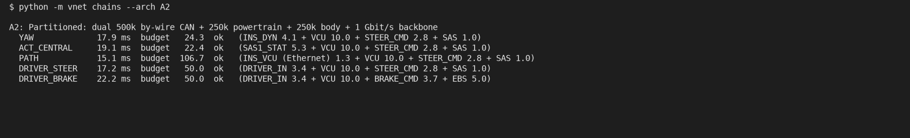

## What is in it

| Part | Where | What it does |
|---|---|---|
| Dossier | `DOSSIER.md` | Needs, ConOps, modes and states, 23 requirements traced to sources and tests, architecture, interface register and ICD, budgets, trade study, M&S credibility, FMEA/RBD, V&V plan, decision log, limits |
| CAN frames | `vnet/canframe.py` | Frames bit by bit (CRC-15, stuffing), worst-case length bound, CAN FD lengths |
| Response-time analysis | `vnet/rta.py` | Revised exact analysis (busy period, all instances), error model, legacy and sufficient tests |
| CAN simulator | `vnet/cansim.py` | Discrete-event arbitration with exact frame lengths and error frames; critical-instant scenarios |
| J1939 and message sets | `vnet/j1939.py`, `network.py`, `data/messages.yaml`, `docs/vehicle.dbc` | 29-bit identifiers, PGNs, transport protocol, per-architecture buses, growth model |
| Ethernet | `vnet/ethernet.py` | Network-calculus bounds for strict-priority switches, packet-level simulator |
| Vehicle dynamics | `vnet/dynamics.py` | Multi-axle single-track model, actuator, yaw / position / path loops, margins, time-domain check |
| Latency chains | `vnet/latency.py` | Data age across tasks, CAN and Ethernet |
| Dependability code | `c/e2e_guard.c`, `vnet/e2e.py`, `vnet/faults.py` | E2E protect/check, redundancy manager, bus guardian (C99), fault confinement, virtual-bus run |
| Trade study, RMA | `vnet/aoa.py`, `vnet/rma.py` | Screening, utilities, FOM, sensitivity, Monte Carlo; RBD with common cause |

## Figures

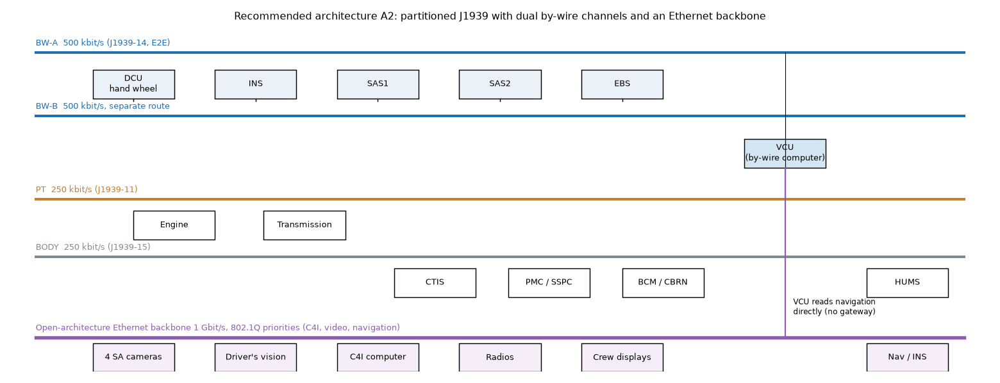

| | |
|---|---|
| 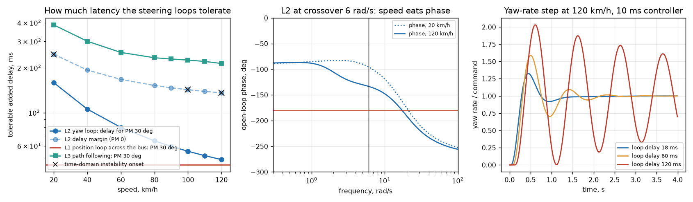 | 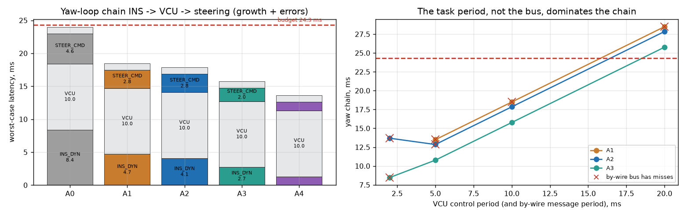 |
| 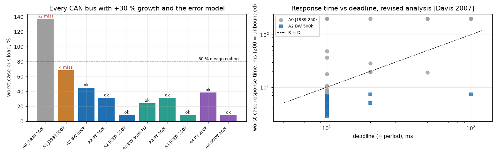 | 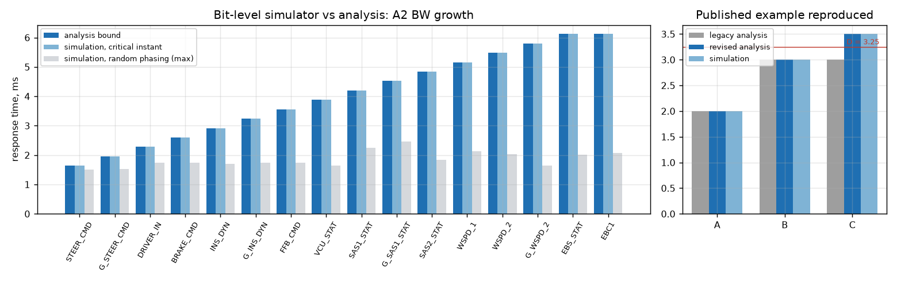 |
| 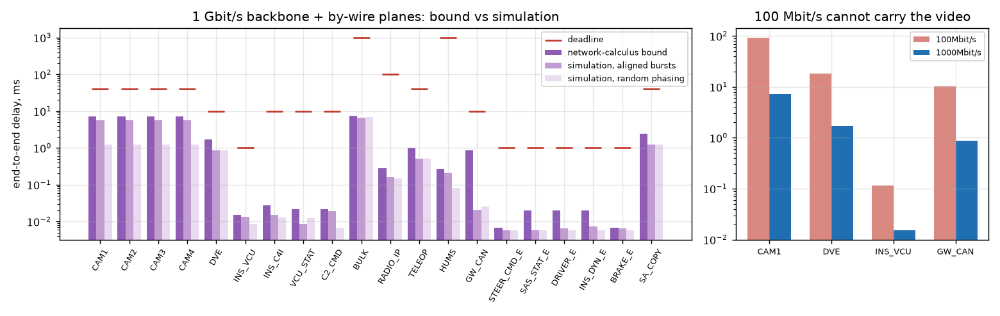 | 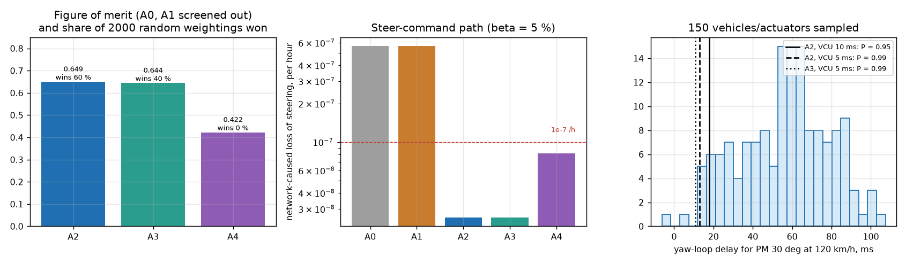 |

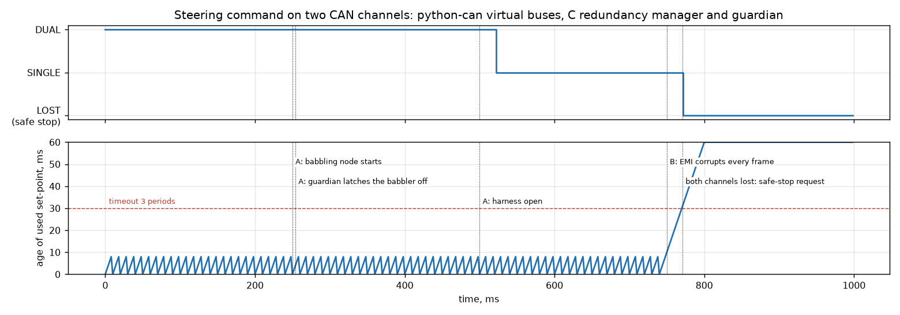

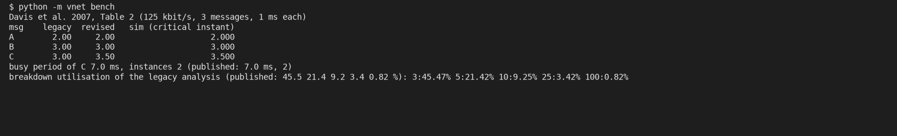
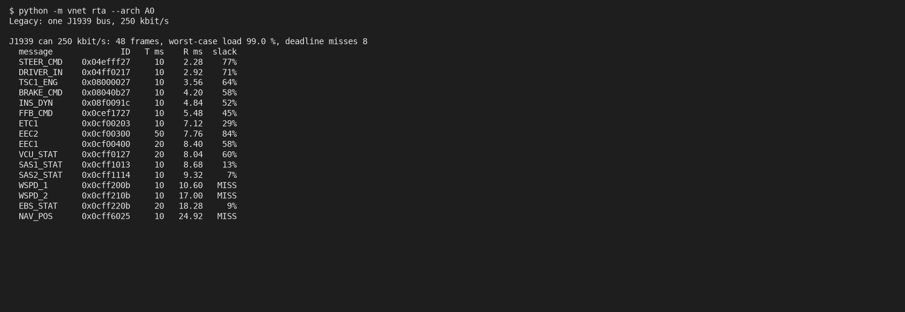
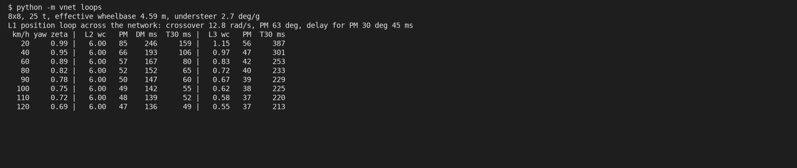
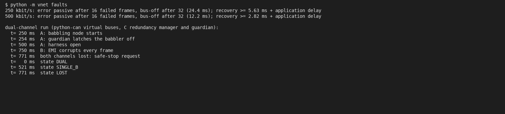

## Limits

Read [DOSSIER section 16](DOSSIER.md#16-limits-and-what-is-assumed-versus-sourced). In short:
- The network analysis rests on the CAN and Ethernet standards and is verified against a published benchmark and two independent simulators.
- The latency budgets come from a linear vehicle model with assumed parameters; a Monte Carlo over them is reported, and the actuator bandwidth is the input to measure first.
- Message periods, traffic, failure rates and the judged trade-study scores are assumptions, stated and swept.
- Nothing was run on hardware: the hardware-in-the-loop and EMC tests are in the V&V plan.

## License

MIT, see [LICENSE](LICENSE).
